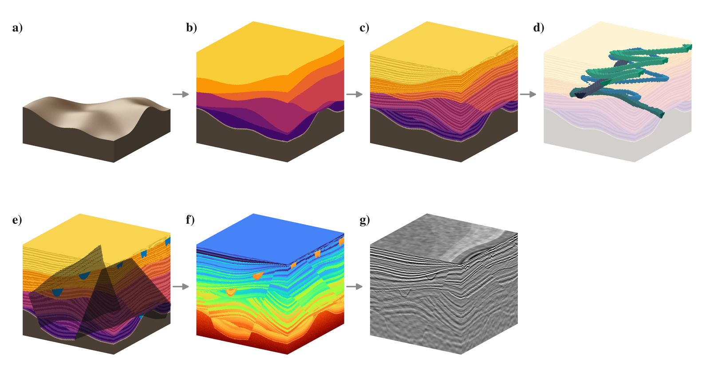
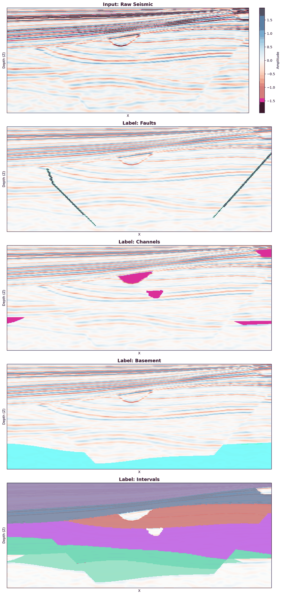

# SynSeis3D

**SynSeis3D** is an open procedural engine that builds 3-D geological models,
computes their synthetic seismic response, and writes voxel-aligned
interpretation labels for **faults, channels, basement, and stratigraphic
intervals**, all from the same realization and with no manual annotation.
It is intended for generating labeled training and benchmark data for
multi-task seismic interpretation.

This repository contains the generator described in:

> Zhou, Q., Morales, M. M., Prodanović, M., Pyrcz, M. J. *SynSeis3D: An Open
> Procedural Engine and Multi-Task Labeled Dataset of Synthetic 3-D Seismic
> Volumes.* Submitted to *Computers & Geosciences*.

## Workflow



*The seven generation steps applied to one model (Fig. 1 of the paper; this
is the model produced by the quick example below).*

Each model is built in seven sequential steps (all in `geomodel.py`):

1. **Basement surface** (a): regional trend, multi-scale correlated relief,
   domes/troughs, and a weathered zone.
2. **Depositional intervals** (b): stacked sequence boundaries; younger surfaces
   erosionally truncate older intervals (candidate and preserved geometry are
   both kept).
3. **Internal bedding** (c): proportional, onlap, or truncation bedding per
   interval.
4. **Channels** (d): sinuous centerlines with parabolic scours, clipped to the
   preserved host interval, with bottom-parallel fill bedding.
5. **Faults** (e): planar normal faults (through-going or blind with a
   displacement taper), applied to all geological fields by one inverse
   coordinate map.
6. **Acoustic properties** (f): depth-trend Vp and density with bed-, channel-,
   and basement-specific perturbations; impedance Z = Vp·ρ.
7. **Seismic response** (g): normal-incidence reflectivity convolved with three
   Ricker bands, depth-dependent band blending (attenuation proxy), amplitude
   taper, lateral smoothing, and band-limited correlated noise.

## Requirements

- Python ≥ 3.9
- `numpy`, `scipy`, `pyyaml`, `matplotlib` (no GPU needed)

## Installation

```bash
git clone https://github.com/zhouqianqianalana/SynSeis3D.git
cd SynSeis3D
pip install -r requirements.txt
```

Or, with [uv](https://docs.astral.sh/uv/) (uses the pinned versions in `uv.lock`):

```bash
uv sync
```

(With uv, prefix the commands below with `uv run`, e.g. `uv run python examples/quick_example.py`.)

## Quick example (test run)

```bash
python examples/quick_example.py
```

This generates one 256³ model in about 10 s on one CPU core, prints label
statistics, and saves a figure of the section Y = 128 to
`outputs/example/DL_Visualization_Y128.png`. The default settings (seed 42,
6 interval boundaries, 4 channels, 3 requested faults) reproduce the model
shown in Figs. 1–8 of the paper, so the section below is the same one shown in
the paper's Fig. 6. Expected output:

```
Generating a 256^3 model (seed 42) ...
Warning: Grid too crowded! Skipping Fault 3 entirely.
Pipeline finished in 9.4 s
Seismic: shape (256, 256, 256), RMS 0.640
Faults   :  0.86 % of voxels
Channels :  1.63 % of voxels
Basement : 14.22 % of voxels
Intervals: classes [0, 1, 2, 3, 4, 5, 6, 7] (0 = basement)
...
Visualization complete! Saved to: outputs/example/DL_Visualization_Y128.png
```

The warning is expected: the third requested fault would lie too close to
the other two and is rejected (see Section 3.2 of the paper).



*Section Y = 128 of the quick-example model: seismic and its four labels.*

The same seed always produces the same model, so your numbers should match
these (tiny differences are possible across library versions); the run time
depends on the machine. Options:
`--grid N` (e.g. `--grid 128` for a faster run), `--seed N`, `--out DIR`,
`--config FILE`.

## Generating a dataset

```bash
python batch_generate.py --num-models 230 --output-dir outputs/dataset
```

With the default `config.yaml`, this regenerates the 230-model, 256³ corpus
described in the paper. Each model is drawn from a fixed master random
stream, so any model can be regenerated on its own:

```bash
# models 100-149 only (e.g. one task of a SLURM array job)
python batch_generate.py --start-index 100 --num-models 50 --output-dir outputs/dataset
```

On one CPU core, a 256³ model takes about 10 s and needs about 2 GB of RAM.

To plot a generated model:

```bash
python visualize_dl_dataset.py outputs/dataset/model_0000 --axis y --index 128
```

## Output format

Each model directory contains:

```
model_0000/
├── config_run.yaml          # full configuration incl. random seed (provenance)
├── metadata_step1..7.json   # realized parameters of each step (faults, channels, ...)
├── DL_Input_Seismic.npy     # seismic amplitudes, float32, shape (nx, ny, nz)
├── DL_Label_Faults.npy      # fault planes, uint8 {0, 1}
├── DL_Label_Channels.npy    # channel bodies, uint8 {0, 1}
├── DL_Label_Basement.npy    # basement incl. weathered zone, uint8 {0, 1}
└── DL_Label_Intervals.npy   # stratigraphic interval index, uint8 (0 = basement, 1 = oldest)
```

Arrays are indexed `[x (inline), y (crossline), z (depth)]`; the vertical
sample interval is 10 m.

## Configuration

All geological and seismic parameters are set in `config.yaml`; `[lo, hi]`
ranges are sampled independently for each model. In batch mode the following
are also randomized per model (`draw_model_config` in `batch_generate.py`):
the number of interval boundaries (3–7), channels (1–6), and requested faults
(0–4); the random seed; and, when `batch_randomize_seismic: true`, the noise
level (0.08–0.30), lateral smoothing σ (0.5–2.0 voxels), amplitude-taper
factor (1.0–2.2), and a common wavelet-width scale (0.7–1.3).

## Repository contents

| Path | Description |
|---|---|
| `geomodel.py` | The seven-step generator; each step is a callable function |
| `batch_generate.py` | Batch generation CLI, per-model randomization, label extraction |
| `config.yaml` | Configuration used for the paper (256³ grid) |
| `visualize_dl_dataset.py` | Plots one vertical section of a model and its four labels |
| `examples/quick_example.py` | Single-model example with figure |

## Citation

If you use SynSeis3D, please cite the paper above (citation details will be
updated on publication).

## License

MIT License, see [LICENSE](LICENSE).

## Contact

Qianqian Zhou, The University of Texas at Austin (qianqianzhou@utexas.edu).
Please report problems through
[GitHub Issues](https://github.com/zhouqianqianalana/SynSeis3D/issues).
